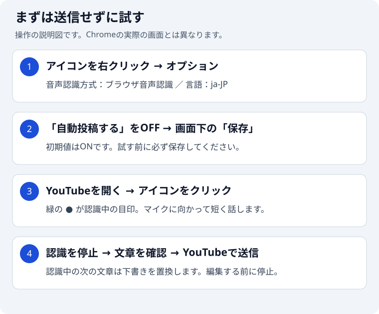

# Voice Live Comment

音声認識でYouTube Liveのチャットにコメントを入力・投稿するChrome拡張機能です。
視聴ページとYouTube Studioの両方で使えます。

**まずは自動投稿をOFFにして試してください。** 初期設定ではONのため、認識した言葉がそのまま投稿される場合があります。

## 必要なもの

- Google Chrome（Manifest V3対応）
- コメントを投稿できるYouTubeアカウントと、チャットが利用できるライブ配信
- マイク

YouTubeの視聴ページ（`youtube.com/live/*`・`youtube.com/watch*`）とYouTube Studio（`studio.youtube.com/*`）で使えます。

## インストール（通常利用）

通常利用では `npm install` や `npm run build` は不要です。

1. [GitHub Releases](https://github.com/mizucopo/voice-live-comment/releases) から `voice-live-comment-X.Y.Z.zip` をダウンロードします。
2. zipファイルを展開します。
3. Chromeで `chrome://extensions/` を開きます。
4. 右上の「デベロッパーモード」をONにします。
5. 「パッケージ化されていない拡張機能を読み込む」をクリックします。
6. 展開先にある `manifest.json` と同じフォルダを選択します。

ツールバーのパズル型の拡張機能メニューから「Voice Live Comment」を固定すると、開始・停止しやすくなります。

## 最初の設定

1. ツールバーのVoice Live Commentアイコンを右クリックし、「オプション」を開きます。
2. STTプロバイダー（音声認識方式）は、まず「ブラウザ音声認識」を選びます。外部APIキーの入力は不要です。
3. 「自動投稿する」をOFFにし、言語コードが `ja-JP` であることを確認します。
4. **画面下までスクロールして「保存」を押します。**

画像は操作の説明図で、実画面のスクリーンショットではありません。インストール直後の自動投稿はONです。

## 話してコメントを入力する

1. YouTube Liveの視聴ページかYouTube Studioを開き、チャットが表示されていることを確認します。
2. ツールバーのVoice Live Commentアイコンをクリックします。緑色の「●」が認識中の目印です。
3. マイクの使用許可を求められた場合は、内容を確認して許可します。
4. マイクに向かって短い文章を話します。認識結果がチャットの入力欄に入ったら、アイコンをもう一度クリックして認識を停止します。誤変換を直してから、YouTubeの送信操作で投稿します。
5. 続けるときは再びアイコンをクリックします。終了時は停止していることを確認してください。

認識中に次の文章が届くと、未送信の入力内容も置き換わります。手直しする前に認識を停止してください。

自動投稿を使いたい場合は、認識結果を確認してから設定の「自動投稿する」をONにして保存してください。ONの間は、認識結果が自動で投稿されます。独り言や周囲の会話にも注意してください。

| アイコンのバッジ | 状態   | 操作                   |
| ---------------- | ------ | ---------------------- |
| なし             | 停止中 | クリックして開始       |
| ●（緑）          | 認識中 | クリックして停止       |
| ×（赤）          | エラー | 通知の内容と設定を確認 |

## 認識を自分に合わせる

- **ゲーム名・人名の誤変換を減らす：** ワードブーストやカスタム辞書を登録し、ゲーム別にプリセットを保存できます。[画像付きの辞書設定](docs/settings.md#ゲーム別の辞書プリセットを使う)
- **音声認識方式を変更する：** Google Cloud STTやGrok STTも利用できます。各サービスのAPIキーが必要で、利用料金が発生する場合があります。[設定一覧](docs/settings.md)
- **投稿前にAIで確認する：** Jevの投稿前レビューを任意で有効化できます。[送信される情報と設定方法](docs/settings.md#jevの投稿前レビューを使う)
- **小さい声が拾われない：** 認識音量しきい値を少しずつ下げ、自動投稿OFFで試します。[Grok STTの調整](docs/settings.md#grok-sttの認識を調整する)

ブラウザ音声認識は、オンデバイスモデルを選んでも、モデルが利用できない場合などにクラウド認識へ自動で切り替わります。音声が外部処理される可能性があるため、必ずローカルだけで処理される設定ではありません。APIキーを含む設定はChrome同期ストレージに保存されます。詳しくは[設定ガイド](docs/settings.md)を確認してください。

## うまく動かないとき

- **コメントが入らない：** 対応するライブ配信ページか、チャットが利用可能かを確認します。投稿前レビューをONにしている場合は、却下された文章は入力されません。
- **赤い×やエラー通知が出る：** マイクの使用許可、選択した音声認識方式、必要なAPIキーを確認します。設定を直したら保存し、停止・開始して試してください。
- **辞書の切り替えが反映されない：** プリセットを選んだ後に「保存」を押します。未保存の編集がある場合は、先に保存してください。
- **拡張機能を更新したい：** 新しい配布ZIPを展開して既存の読み込み先を更新し、`chrome://extensions/` で拡張機能の再読み込みを行います。YouTubeページも再読み込みしてください。

## 開発・ライセンス

開発環境・ビルド・テストは[開発者向けガイド](docs/development.md)、変更の提出は[CONTRIBUTING.md](CONTRIBUTING.md)を参照してください。

[MIT License](LICENSE)
