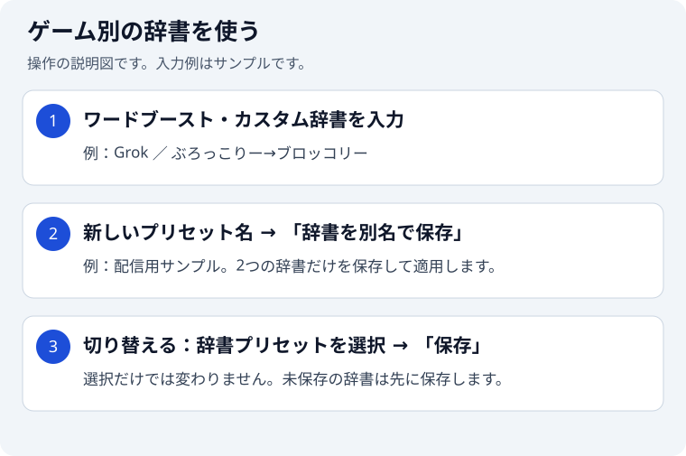

# 設定ガイド

[READMEへ戻る](../README.md)

ツールバーの拡張機能アイコンを右クリックし、「オプション」から設定画面を開きます。

STTプロバイダーは設定画面の3種類から選択します。不正な保存値は別のプロバイダーへ自動置換せず、音声認識を開始せずに設定エラーを表示します。設定画面で利用するプロバイダーを選択し、保存してください。

| 設定項目                   | デフォルト   | 説明                                                                                                                               |
| -------------------------- | ------------ | ---------------------------------------------------------------------------------------------------------------------------------- |
| 自動投稿する               | ON           | ONの場合は認識テキストを送信し、OFFの場合は入力欄への反映のみ行います。投稿前レビューがONなら承認後に反映します。                  |
| 言語コード                 | ja-JP        | 音声認識の言語（例: `en-US`, `ko-KR`, `zh-CN`）                                                                                    |
| STTプロバイダー            | ブラウザ標準 | 音声をテキスト化するSTTプロバイダーを選択します。                                                                                  |
| 認識音量しきい値           | 0.05         | 値を上げるほど小さい声を拾いにくくなります。`0.00` にすると音量による除外を行いません。                                            |
| ワードブースト             | （なし）     | 認識優先度を上げたい言葉を1行に1つ入力します。ブラウザのオンデバイスモデル、Grok STTで使用されます。                               |
| カスタム辞書               | （なし）     | `誤認識→正しい表記` の形式で、認識後のテキストを置換します。                                                                       |
| Google APIキー             | （なし）     | Google Cloud STT使用時のAPIキー                                                                                                    |
| xAI APIキー                | （なし）     | Grok STT使用時のAPIキー                                                                                                            |
| 投稿前レビューを有効にする | OFF          | Jevでコメント本文を評価し、承認時だけ入力・投稿します。全STTプロバイダーで利用できます。                                           |
| TypeSafe APIキー           | （なし）     | 投稿前レビューで使用するTypeSafeのAPIキー                                                                                          |
| レビュー基準               | 標準の基準   | 独り言・短い感想・相づちを許可し、明らかな誤認識や不適切な内容を除外します。自由に編集でき、空欄で保存すると標準の基準に戻ります。 |

### オンデバイスモデルを使う

「オンデバイスモデルを使用（Chrome 138+）」は初期設定でOFFです。対応するChromeでは音声をローカルで処理でき、初回はモデルのダウンロードが必要です。モデルの利用可否や認識開始時の問題により、クラウド認識へ自動で切り替わる場合があります。ONにしても外部送信を完全に禁止する設定ではありません。

### ゲーム別の辞書プリセットを使う

画像は操作の説明図で、実画面のスクリーンショットではありません。入力例はサンプルです。

初回は、これまで保存していたワードブーストとカスタム辞書を「標準」として表示します。読み込みだけではストレージを書き換えず、次の保存成功時にプリセットも保存します。

1. ワードブーストとカスタム辞書をゲームに合わせて編集します。
2. 「新しいプリセット名」にゲーム名などを入力し、「辞書を別名で保存」を押します。2つの辞書を新しい名前で保存し、その辞書を適用します。「標準」や既存の別のプリセットは残ります。
3. 切り替えるときは「辞書プリセット」で名前を選び、内容を確認して画面下の「保存」を押します。選択だけでは動作中の辞書は変わりません。
4. 選択中のプリセットを更新する場合は、辞書を編集して「保存」を押します。

未保存の辞書編集がある間は切り替えを止め、入力内容を保持します。「保存」または「辞書を別名で保存」で残してから切り替えてください。同名の別名保存はできません。プリセット名の変更・削除は現時点では対応していません。

プリセットに含むのはワードブーストとカスタム辞書だけです。APIキー、STTプロバイダー、自動投稿、投稿前レビューなどは切り替えません。「辞書を別名で保存」は他の設定の編集を保存しません。画面下の「保存」は、従来どおり画面全体の設定も保存します。

プリセットはChrome同期ストレージに保存します。容量制限や通信などで保存に失敗した場合は、保存済みの内容と画面の入力内容を保持し、エラーを表示します。入力を控えるか再試行するまで画面を閉じないでください。プリセットの各辞書項目は、従来のワードブースト・カスタム辞書と同じ1項目8KBの上限で保存します。全体の同期ストレージ容量（100KB）などの制限に達すると、新しいプリセットを保存できない場合があります。別の画面・端末による辞書の変更を検知した場合も上書きせず停止します。編集中の内容を控え、画面を開き直してからやり直してください。

### Jevの投稿前レビューを使う

1. [TypeSafeのコンソール](https://console.typesafe.ai/)で取得したAPIキーを「TypeSafe APIキー」に入力します。
2. 「投稿前レビューを有効にする」をONにします。
3. 必要に応じてレビュー基準を編集し、保存します。

レビューをONにすると、既存フィルターを通過しカスタム辞書を適用したコメント本文とレビュー基準をTypeSafeへ送信します。音声や配信内容、チャット履歴はレビューに送信しません。APIの利用料金が発生する場合があります。APIキーを含む設定は、既存のAPIキー設定と同じChrome同期ストレージに保存します。

Jevが承認した本文は、自動投稿ONなら送信し、OFFなら入力だけ行います。却下された本文は入力も投稿もせず、元の下書きを保持します。通常の却下は通知しません。APIキー未設定、通信失敗、不正な応答、10秒のタイムアウト時にも入力・投稿せず、エラーを通知して次のコメントの処理を続けます。

連続したコメントは認識結果の受付順に処理します。音声認識の停止や設定変更時にはレビュー・送信待ちを取り消します。承認後に入力欄を手動編集した場合、その文は自動送信しません。ユーザー自身によるYouTube上の手入力・送信はレビュー対象外です。

初期基準では独り言・短い感想・相づちを許可し、明らかに意味の通らない認識結果、誹謗中傷、脅迫、公開すべきでない個人情報を除外します。本文だけで判定するため、音声との不一致や配信の文脈に依存する誤認識をすべて検出できるわけではありません。モデルによる判定が意図と異なる場合はレビュー基準を調整してください。

参考: [TypeSafe APIの公式仕様](https://docs.typesafe.ai/api)。`jev-latest`のChoiceで投稿可否を判定します。

### Grok STTの認識を調整する

- 日本語で使う場合は、言語コードを `ja-JP` にします。Grokから返された検出言語が設定と異なる結果は、長さに関係なく入力・投稿から除外します。意図的に外国語でコメントする場合は言語コードを変更してください。
- Grok APIの言語指定は数値などの表記整形用で、認識言語を固定するものではありません。検出言語がない場合、日本語設定では日本語を含まない韓国語などの表記や、一部の既知の中国語短文も除外します。漢字だけの文章や英字の固有名詞は判別が難しく、すべての外国語結果を除外できるわけではありません。
- ワードブーストには、配信名・人名・ゲーム用語など、実際に使う言葉を1行に1つ登録します。Grokでは最大100件、1件50文字までです。たとえば `Voice Live Comment` と `Grok` は別の行に入力します。
- 同じ誤変換を繰り返す場合は、カスタム辞書に `誤認識→正しい表記` を登録します。辞書は認識後の文字列を置換するため、短すぎる置換元は別の単語も変えてしまうことがあります。実際の誤変換に絞って登録してください。
- 調整中は自動投稿をOFFにし、普段の声で短文・固有名詞を含む文章を話して確認できます。小さい声が拾われない場合は、認識音量しきい値を少しずつ下げて確認してください。

音声変換時の歪みを抑える処理は自動で適用されます。

参考: [xAI Speech to Textの公式仕様](https://docs.x.ai/developers/model-capabilities/audio/speech-to-text)
